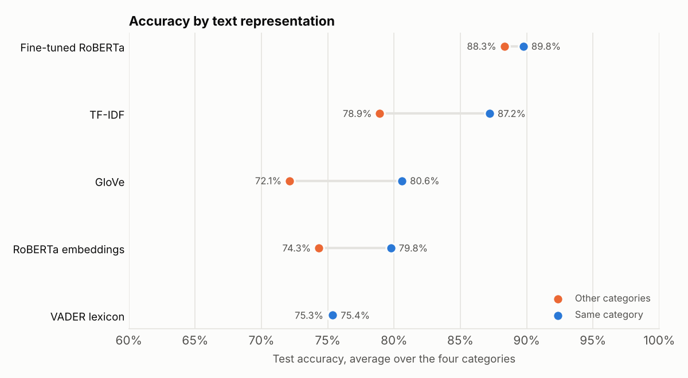
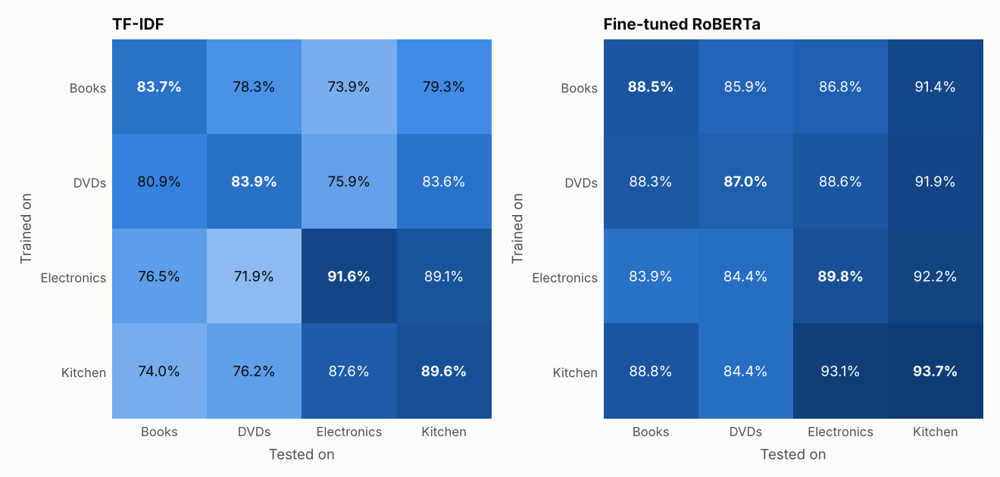
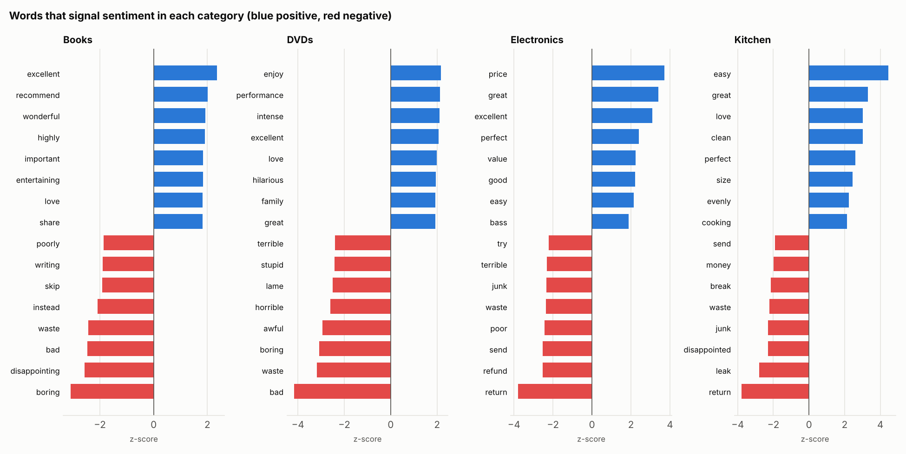
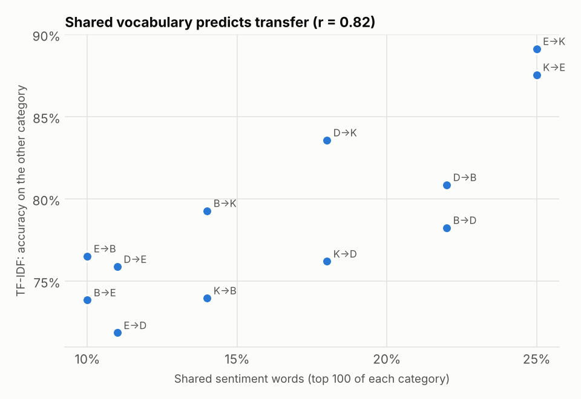
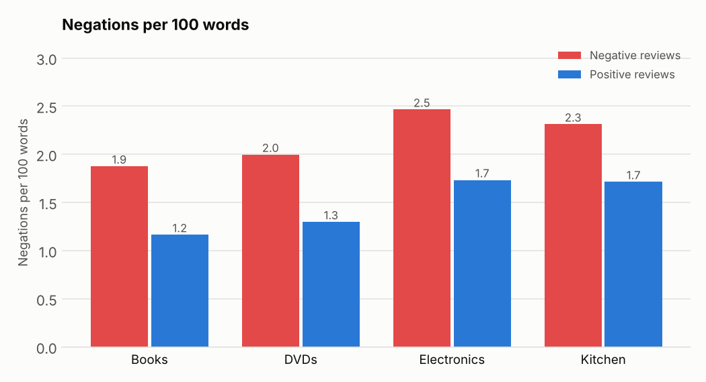
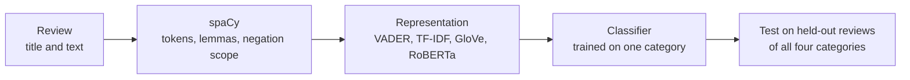

# Sentiment Analysis of Product Reviews

[](https://github.com/martinaserbann/product-review-sentiment/actions/workflows/tests.yml)

Classifying Amazon product reviews as positive or negative, and testing whether a model trained on one product category still works on another. Five text representations, from a hand-built sentiment lexicon to a fine-tuned transformer, are compared on the Multi-Domain Sentiment Dataset (Blitzer et al., 2007): 7,853 reviews of books, DVDs, electronics and kitchen products.

Follows the project guidelines of the Text Mining and Natural Language Processing course, BSc in Artificial Intelligence (University of Milano-Bicocca).

## Results

Every model is trained on one category and tested on held-out reviews of all four (20% of each category, never seen in training). Positive and negative reviews are balanced, so a coin flip scores 50%.

| Model | Representation | Same category | 95% interval | Other categories |
|---|---|---|---|---|
| **Fine-tuned RoBERTa** | Transformer fine-tuned as a classifier | **89.8%** | 88.2% to 91.2% | **88.3%** |
| TF-IDF | Lemmas and bigrams, negation marked | 87.2% | 85.7% to 88.8% | 78.9% |
| GloVe | Average of pretrained word vectors | 80.6% | 78.8% to 82.5% | 72.1% |
| RoBERTa embeddings | Average of frozen transformer token vectors | 79.8% | 77.8% to 81.8% | 74.3% |
| VADER lexicon | Hand-built sentiment rules, nothing learned | 75.4% | 73.2% to 77.5% | 75.3% |

TF-IDF, GloVe and the RoBERTa embeddings feed a logistic regression tuned by cross-validation on the training reviews. "Same category" averages the four in-category accuracies; "other categories" averages the 12 combinations of a training category with a different test category.



- **Fine-tuning is what makes the transformer work.** Kept frozen and averaged, RoBERTa's token vectors (79.8%) are no better than averaged GloVe vectors (80.6%): they were never trained for sentiment, and averaging them over a whole review blurs them. Fine-tuned, the same encoder is the best model.
- **A well-preprocessed TF-IDF model is a strong baseline**: 87.2%, 2.6 points below fine-tuned RoBERTa, above the original paper's 83.7%, at a tiny fraction of the cost. On electronics it is even slightly ahead (91.6% against 89.8%, within the uncertainty of 394 test reviews).
- **VADER needs no training data** but stays at 75.4%: its general-purpose lexicon has no entry for "return", "refund" or "junk", nor for "sturdy", words that decide many product reviews.

## Changing category



Rows are the category a model was trained on, columns the category it is tested on, so the diagonal is in-category accuracy. TF-IDF loses 8.3 points on average when the category changes; the worst case is electronics → DVDs, 71.9% against 83.9% for a model trained on DVDs. Fine-tuned RoBERTa loses only 1.5 points: what it learned in pretraining carries over, while TF-IDF only knows the words of its training category.

Why? Each category voices sentiment with its own words. Ranked by how strongly they separate positive from negative training reviews (log-odds ratio with an informative Dirichlet prior, Monroe et al., 2008), book and DVD reviewers judge the content, while electronics and kitchen reviewers judge the product and the purchase:



Of the 100 strongest sentiment words of each category, books and DVDs share 22% and electronics and kitchen 25%, but books and electronics only 10%. That overlap predicts how well TF-IDF transfers from one category to another (r = 0.82 over the 12 pairs); for fine-tuned RoBERTa the link is weaker (r = 0.52).



## What helped the TF-IDF model

Each preprocessing step was scored by 5-fold cross-validation on the training reviews only:

| Variant | Books | DVDs | Electronics | Kitchen | Average |
|---|---|---|---|---|---|
| Words | 83.1% | 83.2% | 85.4% | 87.0% | 84.7% |
| Lemmas | 83.8% | 83.4% | 84.0% | 85.8% | 84.3% |
| Words and bigrams | 83.8% | 84.3% | 86.7% | 88.9% | 85.9% |
| Lemmas and bigrams | 84.2% | 84.3% | 87.0% | 87.7% | 85.8% |
| Words and bigrams, negation marked | 83.8% | 84.4% | 88.2% | 89.3% | 86.4% |
| **Lemmas and bigrams, negation marked** | 84.1% | 85.2% | 88.0% | 88.6% | **86.5%** |

- **Lemmatization alone does not help**, because tense carries sentiment in product reviews: in electronics and kitchen reviews "works" leans positive and "worked" negative ("it worked for two weeks"), and lemmatization merges both into "work".
- **Bigrams help most**, and **negation marking** adds a little more. Negations are a strong cue: in every category negative reviews use 1.35 to 1.6 times as many as positive ones, and 87% of them contain at least one, against 70% of positive reviews. Marking their scope (`not good at all` becomes `not NOT_good NOT_at NOT_all`) lets a bag-of-words model tell "good" from "not good".



## Compared with published results

| Same category | Books | DVDs | Electronics | Kitchen | Average |
|---|---|---|---|---|---|
| Blitzer et al. (2007), linear model on unigrams and bigrams | 80.4% | 82.4% | 84.4% | 87.7% | 83.7% |
| This project: TF-IDF | 83.7% | 83.9% | 91.6% | 89.6% | 87.2% |
| This project: fine-tuned RoBERTa | 88.5% | 87.0% | 89.8% | 93.7% | 89.8% |

| Other categories, average of the 12 pairs | Accuracy |
|---|---|
| Blitzer et al. (2007), same linear model | 74.5% |
| Blitzer et al. (2007), SCL-MI, adapted with unlabelled reviews of the new category | 78.0% |
| Karouzos et al. (2021), BERT-base fine-tuned on the training category | 89.9% |
| Karouzos et al. (2021), UDALM, adapted with unlabelled reviews of the new category | 91.7% |
| This project: TF-IDF | 78.9% |
| This project: fine-tuned RoBERTa | 88.3% |

The setups differ. Blitzer et al. trained on 1,600 reviews per category and tested on 400; Karouzos et al. fine-tuned BERT-base on 1,600 reviews and tested on all 2,000 of the other category. Here duplicates are removed, each test set has about 390 reviews, and RoBERTa is trained on about 1,400 reviews with half of its layers frozen to fit a CPU. Within those limits, TF-IDF beats the original linear model in every category, and fine-tuned RoBERTa is 1.6 points below the published BERT result across categories, without using any review of the new category.

## Where the models go wrong

The test reviews fine-tuned RoBERTa misclassifies with the most confidence have recognisable causes:

- **Rebuttals of other reviews**, which repeat the complaints they answer: "do not believe the nay-sayers", or a positive review titled "NEVER put a carbon steel knife into the dishwasher!"
- **Stories of a mishap with a happy ending**: a TV that survived a fall, a dish broken in shipping and replaced.
- **A negated comparison**: "I couldn't be more satisfied if my stock pot had cost 10 times as much."
- **Praise before the complaint**: a review that loves the colour and the easy cleaning, then turns with "However, I have noticed...".
- **Comparisons with other brands**: "Nowhere near as good as genuine Wusthof or Henckels".
- **Noisy labels**: some low ratings read as mild ("a great book if you have the right teacher").

Fine-tuned RoBERTa gets 122 in-category test reviews right that TF-IDF gets wrong, and TF-IDF 82 that RoBERTa gets wrong. Many of the first kind are mixed reviews where the turn decides the rating: "The sound is really great, but ... The design flaw makes them unusable for me". TF-IDF adds up the positive words; RoBERTa reads the turn. Others need knowledge rather than sentiment words, such as "Install CD has viruses".

## Approach



- **Data.** 8,000 Amazon reviews: per category, 1,000 positive (4 or 5 stars) and 1,000 negative (1 or 2 stars). 147 reviews are exact copies of another review of the same category; they are removed before splitting, otherwise a test review could also sit in the training data. Each category is split 80/20, stratified by sentiment. The title is kept as the first sentence of the review.
- **Preprocessing.** spaCy's `en_core_web_sm` tokenizes, tags, parses and lemmatizes each review. Negations are found by the parser (`n't`) and a short word list, and their scope runs to the next punctuation mark (Das and Chen, 2001; Pang et al., 2002).
- **Representations.**
  - VADER (Hutto and Gilbert, 2014): a rule-based sentiment lexicon; only its positive/negative cut-off is chosen on the training reviews.
  - TF-IDF: the best variant of the experiments above, with sublinear term frequency.
  - GloVe: the average of 300-dimensional pretrained word vectors (Pennington et al., 2014), loaded with gensim.
  - RoBERTa embeddings: the average of the last-layer token vectors of a frozen RoBERTa-base encoder.
  - Fine-tuned RoBERTa: the same encoder with a new output layer, trained for up to 3 epochs (AdamW, learning rate 3e-5 with warm-up, batches of 16), keeping the first epoch with the best accuracy on 10% of the training reviews. To fit training on a CPU, the bottom 6 of the 12 layers stay frozen, and a review longer than 256 tokens keeps its first and last 127 tokens, where reviewers tend to state and sum up their opinion.
- **Transformer.** RoBERTa-base and its tokenizer come from spaCy's `en_core_web_trf` pipeline, which spaCy further trained for tagging, parsing and named entities. It installs with pip, so the runs can be reproduced exactly.
- **Evaluation.** Accuracy on the held-out reviews, with 95% intervals from 2,000 bootstrap resamples of the test reviews of each category.

## Run it

```bash
pip install -r requirements.txt
python -m review_sentiment.transformer   # RoBERTa: about 2 hours on a CPU, minutes on a GPU
python -m review_sentiment               # everything else, then all tables and figures (about 15 minutes)
python -m unittest discover -s tests     # 24 unit tests
```

The transformer predictions are saved in [results/](results/), so `python -m review_sentiment` works without running the transformer again. The notebook [notebooks/sentiment_analysis.ipynb](notebooks/sentiment_analysis.ipynb) walks through the whole analysis step by step, and [docs/results.md](docs/results.md) has every table.

## Project structure

```
review_sentiment/
    data.py          download (pinned and checksummed), parsing, duplicates, train/test split
    preprocess.py    spaCy tokenization, lemmatization, part-of-speech tags, negation scope
    features.py      TF-IDF, averaged GloVe vectors, VADER scores
    models.py        tuned logistic regression and the VADER cut-off
    transformer.py   RoBERTa embeddings and fine-tuning
    evaluate.py      training on each category, accuracy matrices, bootstrap intervals
    experiments.py   preprocessing experiments for TF-IDF
    analysis.py      text statistics, sentiment words, shared vocabulary, error analysis
    published.py     published results on the same dataset
    plots.py         figures
    __main__.py      entry point for python -m review_sentiment
notebooks/           the analysis, step by step
results/             predictions and training histories of the transformer runs
tests/               unit tests (unittest)
docs/                results tables and figures
```

## Data

Multi-Domain Sentiment Dataset by John Blitzer, Mark Dredze and Fernando Pereira: [Biographies, Bollywood, Boom-boxes and Blenders: Domain Adaptation for Sentiment Classification](https://aclanthology.org/P07-1056/), ACL 2007 ([dataset page](https://www.cs.jhu.edu/~mdredze/datasets/sentiment/)). The labelled reviews are downloaded from the copy published with Ziser and Reichart (2018), pinned to one commit and checked against SHA-256 checksums. Published results for comparison: Karouzos, Paraskevopoulos and Potamianos, [UDALM: Unsupervised Domain Adaptation through Language Modeling](https://aclanthology.org/2021.naacl-main.203/), NAACL 2021.

## Author

Martina Serban · [LinkedIn](https://www.linkedin.com/in/martinaserban/)
